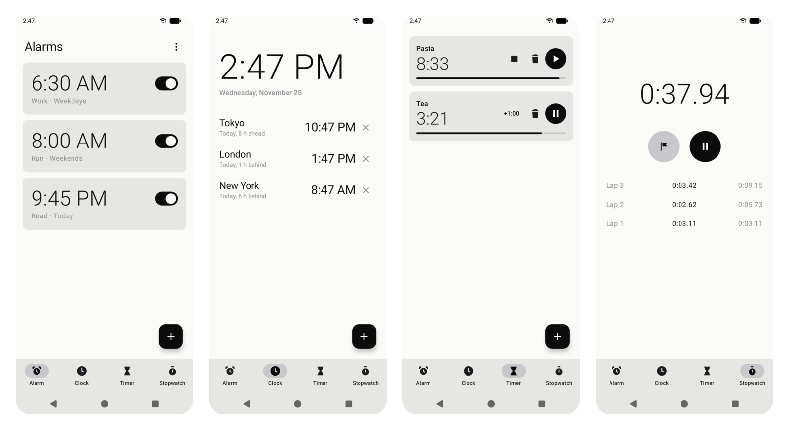

# nacre-apps

Minimal, private system apps for a GrapheneOS-like Android ROM. No Google, no network, no tracking.

 

  <picture>
    <source media="(prefers-color-scheme: dark)" srcset="apps/clock/readme/badge-dark.png">
    
  </picture>

Reliable alarms, world clocks, timers and a stopwatch in one simple app.

  <picture>
    <source media="(prefers-color-scheme: dark)" srcset="apps/clock/readme/screens-dark.png">
    
  </picture>

