# nacre-apps

Minimal, private system apps for a GrapheneOS-like Android ROM. No Google, no network, no tracking.

 

  <picture>
    <source media="(prefers-color-scheme: dark)" srcset="apps/clock/readme/badge-dark.png">
    
  </picture>

Reliable alarms, world clocks, timers and a stopwatch in one simple app.

  <picture>
    <source media="(prefers-color-scheme: dark)" srcset="apps/clock/readme/screens-dark.png">
    
  </picture>

 

  <picture>
    <source media="(prefers-color-scheme: dark)" srcset="apps/calculator/readme/badge-dark.png">
    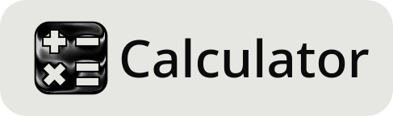
  </picture>

Exact scientific calculator with history and an offline unit, currency and crypto converter.

  <picture>
    <source media="(prefers-color-scheme: dark)" srcset="apps/calculator/readme/screens-dark.png">
    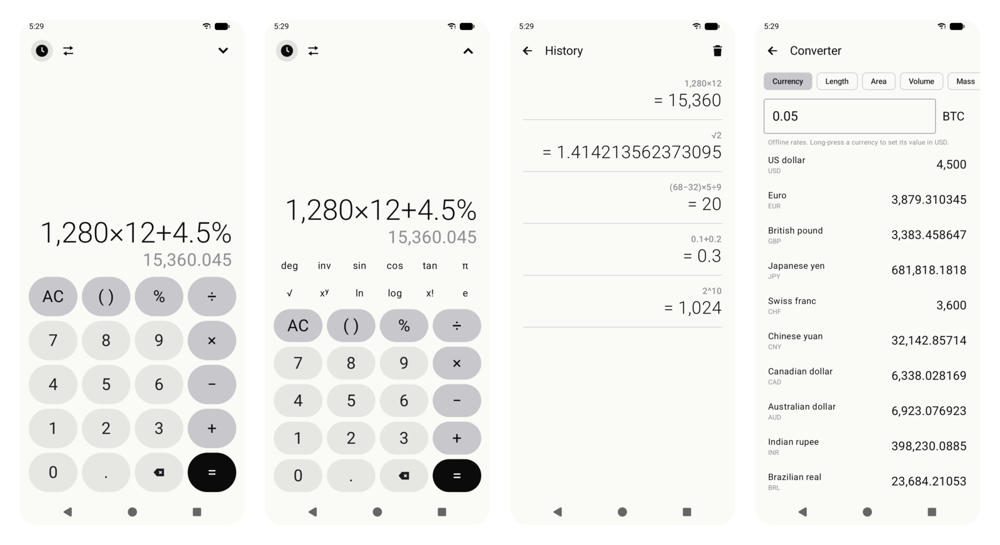
  </picture>

 

  <picture>
    <source media="(prefers-color-scheme: dark)" srcset="apps/contacts/readme/badge-dark.png">
    
  </picture>

On-device address book with favorites, vCard import and export, and full system integration.

  <picture>
    <source media="(prefers-color-scheme: dark)" srcset="apps/contacts/readme/screens-dark.png">
    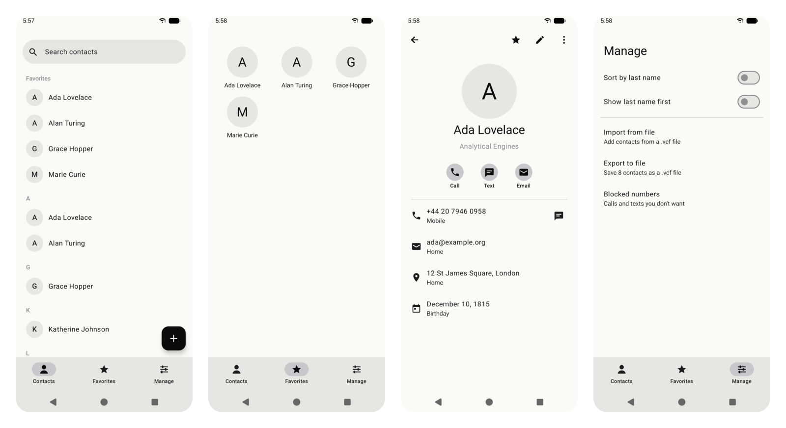
  </picture>

 

  <picture>
    <source media="(prefers-color-scheme: dark)" srcset="apps/phone/readme/badge-dark.png">
    
  </picture>

Default dialer with recents, favorites, smart keypad search and a lock-screen call screen that works before first unlock.

  <picture>
    <source media="(prefers-color-scheme: dark)" srcset="apps/phone/readme/screens-dark.png">
    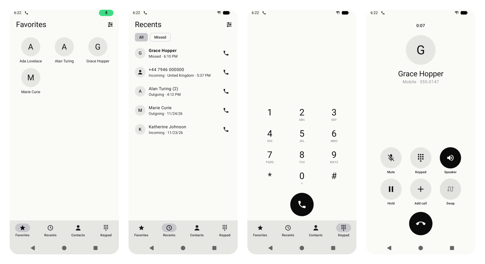
  </picture>

 

  <picture>
    <source media="(prefers-color-scheme: dark)" srcset="apps/messages/readme/badge-dark.png">
    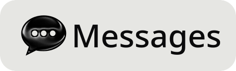
  </picture>

Private texting with group chats, reactions, photos and files over SMS and MMS.

  <picture>
    <source media="(prefers-color-scheme: dark)" srcset="apps/messages/readme/screens-dark.png">
    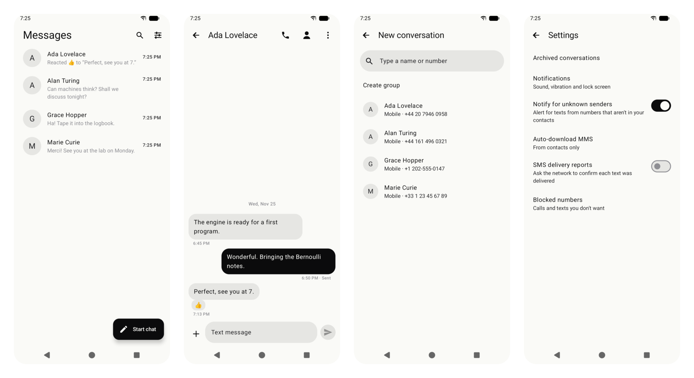
  </picture>

 

  <picture>
    <source media="(prefers-color-scheme: dark)" srcset="apps/launcher/readme/badge-dark.png">
    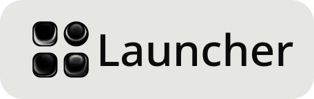
  </picture>

Home screen with folders, widgets, an app drawer with search and work profiles, and every icon in liquid chrome.

  <picture>
    <source media="(prefers-color-scheme: dark)" srcset="apps/launcher/readme/screens-dark.png">
    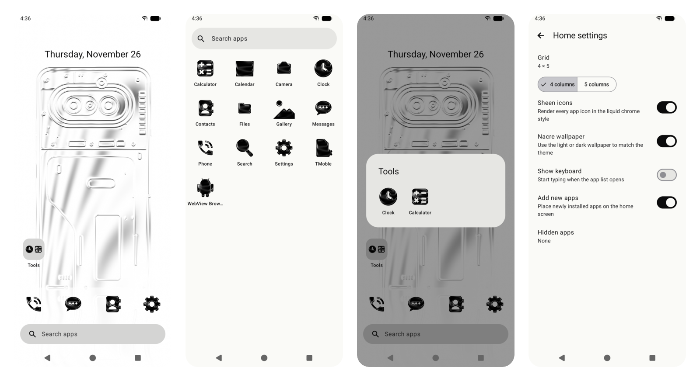
  </picture>

 

  <picture>
    <source media="(prefers-color-scheme: dark)" srcset="apps/camera/readme/badge-dark.png">
    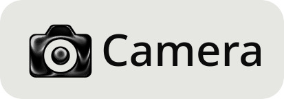
  </picture>

Full-resolution camera with Pro manual controls, RAW, 4K and time-lapse video, document, panorama and QR scanning.

  <picture>
    <source media="(prefers-color-scheme: dark)" srcset="apps/camera/readme/screens-dark.png">
    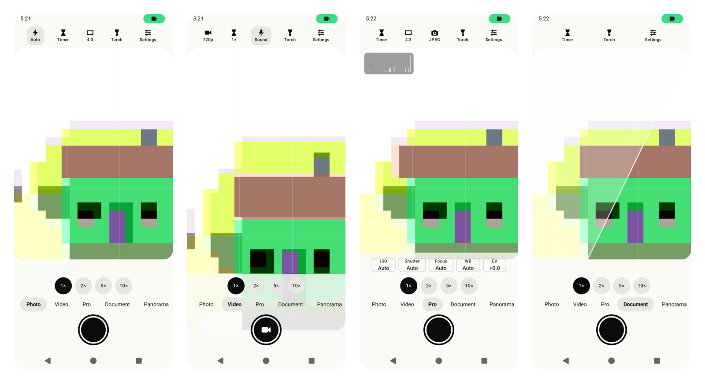
  </picture>

 

  <picture>
    <source media="(prefers-color-scheme: dark)" srcset="apps/gallery/readme/badge-dark.png">
    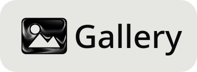
  </picture>

Photo and video library with sortable timelines, albums, favorites, trash, search, and an editor for crop, straighten, adjustments, filters and markup.

  <picture>
    <source media="(prefers-color-scheme: dark)" srcset="apps/gallery/readme/screens-dark.png">
    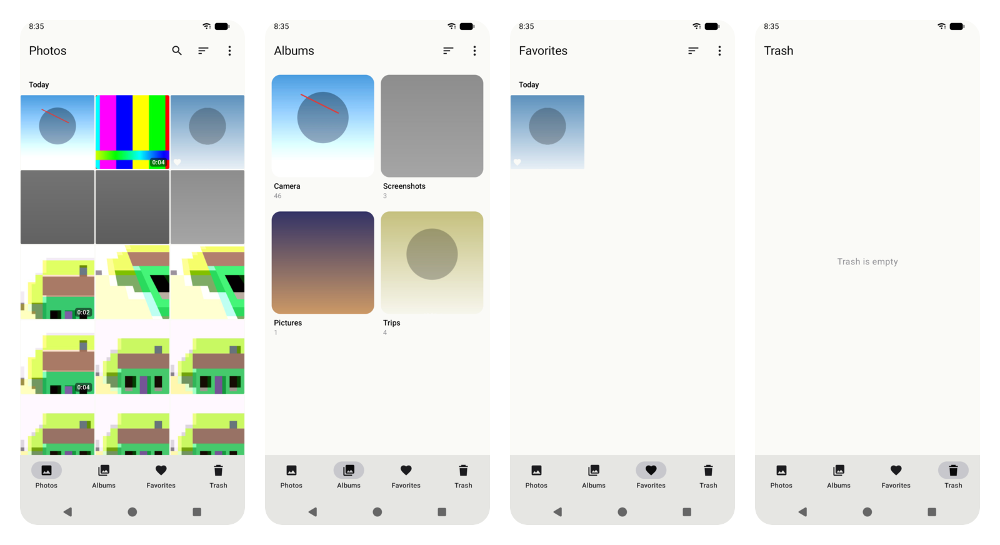
  </picture>

 

  <picture>
    <source media="(prefers-color-scheme: dark)" srcset="apps/files/readme/badge-dark.png">
    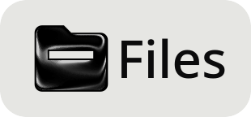
  </picture>

File manager for internal storage, SD cards and USB drives with categories, search, starred files, per-volume trash, undoable copy and move, zip archives, a text editor and a sandboxed PDF viewer.

  <picture>
    <source media="(prefers-color-scheme: dark)" srcset="apps/files/readme/screens-dark.png">
    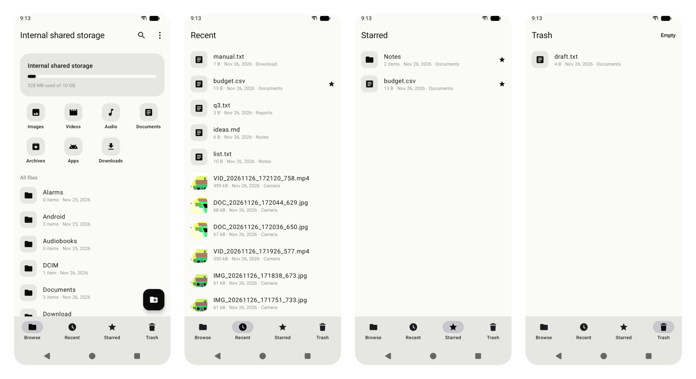
  </picture>

 

  <picture>
    <source media="(prefers-color-scheme: dark)" srcset="apps/keyboard/readme/badge-dark.png">
    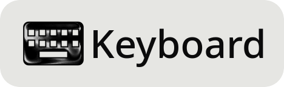
  </picture>

Offline keyboard for English, German, French and Spanish with suggestions, auto-correction, on-device learning, accents, emoji, a memory-only clipboard history and a system spell checker, ready before first unlock.

  <picture>
    <source media="(prefers-color-scheme: dark)" srcset="apps/keyboard/readme/screens-dark.png">
    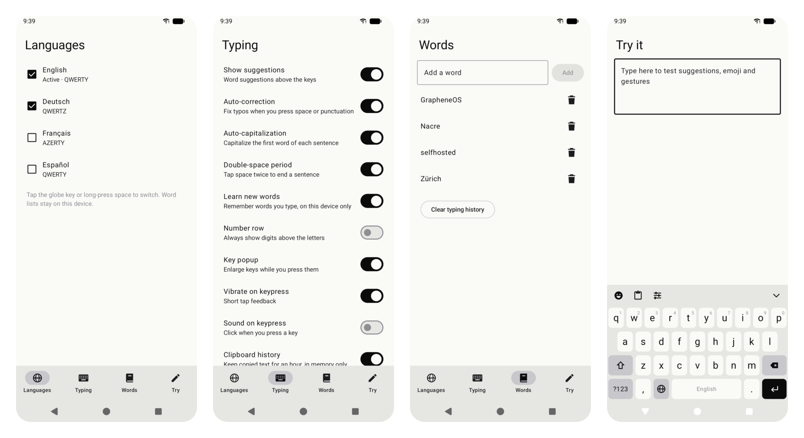
  </picture>

 

<b>Wallpapers</b>

Liquid-chrome diffraction, contour and nacre wallpapers for light and dark mode in the icon sheen style, made by <code>scripts/wallpaper.py</code>.

  <a href="wallpapers">
    <picture>
      <source media="(prefers-color-scheme: dark)" srcset="wallpapers/readme-dark.png">
      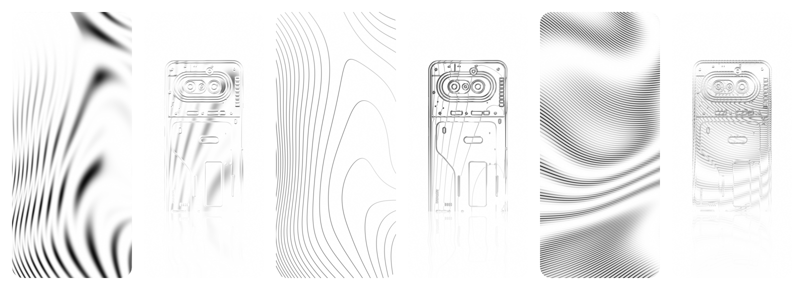
    </picture>
  </a>

